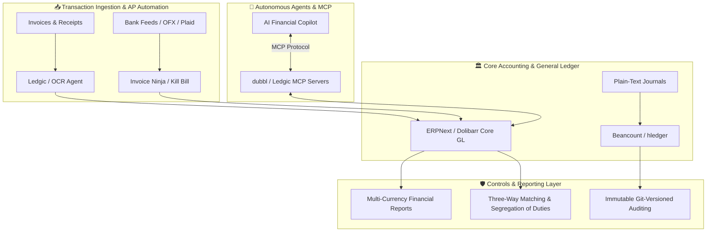

# 💰 Awesome Financial Management

  

  
  
  
  
  
  

---

## 📌 Comprehensive Overview & Ecosystem

Welcome to **Awesome Financial Management** — an authoritative, SEO-indexed, and community-maintained directory of **Enterprise SaaS Platforms**, **Sovereign Open-Source ERPs**, **Automated Bookkeeping Engines**, **FP&A Solutions**, and **Treasury Management Infrastructure**.

Whether you are a **CFO**, **Corporate Controller**, **Treasury Director**, **FinTech Architect**, or **Finance Operations Lead**, this guide offers a rigorous, data-backed taxonomy of software designed to:
- 📊 Maintain audit-proof **General Ledgers** and multi-entity charts of accounts.
- ⚡ Automate **Accounts Payable (AP)** and **Accounts Receivable (AR)** workflows with OCR and three-way matching.
- 🌐 Power real-time **Financial Planning & Analysis (FP&A)**, multi-scenario forecasting, and continuous close cycles.
- 🏦 Execute enterprise **Treasury Management**, liquidity planning, multi-bank reconciliation, and FX exposure hedging.
- 🔓 Deploy **self-hosted, sovereign accounting engines** with zero vendor lock-in or per-seat penalty fees.

---

## 📑 Table of Contents

- [🌐 Sector Overview & Market Dynamics](#-sector-overview--market-dynamics)
- [🏢 Enterprise SaaS & Hosted Platforms](#-enterprise-saas--hosted-platforms)
- [🔓 Open-Source GitHub Projects](#-open-source-github-projects)
- [🧩 Architecture Patterns: Building Sovereign Financial Stacks](#-architecture-patterns-building-sovereign-financial-stacks)
- [🤝 How to Contribute](#-how-to-contribute)
- [📈 Star History](#-star-history)
- [💖 Support & Community](#-support--community)
- [⚖️ Disclaimer](#️-disclaimer)
- [🏷️ Keywords & Search Index](#️-keywords--search-index)

---

## 🌐 Sector Overview & Market Dynamics

The global **Financial Management Software (FMS)** market is estimated at **$25.2 Billion in 2024** and is projected to expand to **$45.8 Billion by 2030**, advancing at a compound annual growth rate (**CAGR of ~10.5%**), accelerated by enterprise migration to cloud general ledgers, autonomous AP/AR automation, and real-time continuous accounting.

From a structural perspective, the sector exhibits **moderate concentration characterized by a bifurcated barbell market**:
- **Enterprise Core Systems (Concentrated Oligopoly):** The core enterprise general ledger and system-of-record tier is highly consolidated around entrenched ecosystem providers—primarily **Microsoft, Oracle NetSuite, SAP, Workday, and ServiceNow**. These mega-cap platforms benefit from extreme operational moats, regulatory certifications, and multi-year migration costs that prevent frequent vendor churn.
- **Specialized Workflows & Point Solutions (Moderately Fragmented):** Surrounding the core ledger, satellite categories such as **Treasury Management Systems (TMS)**, **Collaborative FP&A**, **Financial Close Automation**, and **Global AP Remittance** (e.g., Anaplan, BlackLine, Kyriba, Tipalti) remain moderately fragmented. Simultaneously, a fast-accelerating **open-source and local-first ecosystem** (ERPNext, Maybe, Actual Budget, dubbl) is democratizing access for mid-market and privacy-sensitive enterprises seeking zero per-user licensing fees and sovereign AI integration via Model Context Protocol (MCP) agents.

---

## 🏢 Enterprise SaaS & Hosted Platforms

The table below lists the leading commercial financial management platforms, ranked in **descending order of company size** (market capitalization or institutional enterprise valuation), featuring verified starting tier prices and explicit trial limitations:

| 🏢 Product / Platform | 📈 Company Size (Valuation / Revenue) | 💵 Starting Tier Price | 🎁 Free Tier / Trial Limits | 🔍 Key Capabilities & Target Segment |
| :--- | :--- | :--- | :--- | :--- |
| **[Microsoft Dynamics 365 Finance](https://dynamics.microsoft.com/en-us/finance/)** | **~$3.10 Trillion Market Cap** *(FY24 Revenue: ~$245B)* | **$180 / user / month** *(Standalone base license; $30/user/mo for attached qualifying Dynamics app)* | **30-day free trial** with fully functional sandbox, pre-populated Contoso demo database, and financial reporting modules. | Enterprise GL, multi-currency ledger, AI-driven cash flow forecasting, asset lease accounting, and native Power Platform automation. |
| **[Oracle NetSuite](https://www.netsuite.com/)** | **~$420 Billion Market Cap** *(FY24 Revenue: ~$53B)* | **$999 / month base platform fee** *(+ $99 / user / month)* | **14-day guided product tour & test-drive sandbox** provisioned on-demand by sales engineering; no perpetual free tier. | Cloud ERP with integrated core accounting, billing, ASC 606 revenue recognition, fixed assets, and multi-subsidiary consolidation (OneWorld). |
| **[SAP S/4HANA Finance](https://www.sap.com/products/erp/s4hana-financial-management.html)** | **~$260 Billion Market Cap** *(FY24 Revenue: ~$35B)* | **~$2,500 / month base entry tier** *(~$140 – $260 / user / month for Cloud Public Edition)* | **14-day SAP S/4HANA Cloud free trial** with pre-configured guided business scenarios, universal journal tables, and closing cockpits. | Flagship enterprise ERP accounting; Universal Journal architecture, single source of financial truth, predictive accounting, and treasury risk. |
| **[ServiceNow Financial Management](https://www.servicenow.com/)** | **~$185 Billion Market Cap** *(FY24 Revenue: ~$10B)* | **~$833 / month** *(~$10,000/year base package or ~$100 / fulfiller user / month)* | **Free Personal Developer Instance (PDI)** via ServiceNow Developer Program (perpetually free if active every 10 days); 30-day enterprise evaluation. | IT Financial Management (ITFM), IT service cost modeling, CMDB-to-ledger cost allocation, budgeting, and strategic portfolio spend tracking. |
| **[Workday Financial Management](https://www.workday.com/en-us/products/financial-management/overview.html)** | **~$68 Billion Market Cap** *(FY24 Revenue: ~$7.3B)* | **~$100 – $150 / user / month** *(Typical minimum annual enterprise contract begins at ~$100,000/year)* | **30-day customized preview sandbox** provided during formal enterprise procurement; no public self-serve free tier. | Cloud-native suite pairing financial accounting with HCM on a unified in-memory object model, continuous close, and real-time audit logs. |
| **[Sage Intacct](https://www.sageintacct.com/)** | **~$15 Billion Market Cap** *(Sage Group plc; FY24 Revenue: ~$2.7B)* | **~$750 – $1,100 / month base** *(~$9,000 – $13,200/year base + ~$200 / user / month)* | **30-day interactive test-drive trial** pre-loaded with sample company chart of accounts, multidimensional dimensions, and report templates. | AICPA-endorsed financial management; automated multi-entity rollups, project accounting, contract billing, and SaaS metrics dashboards. |
| **[Anaplan](https://www.anaplan.com/)** | **~$10.7 Billion Valuation** *(Thoma Bravo; Revenue: ~$600M+)* | **~$2,500 – $4,166 / month** *(~$30,000 – $50,000/year base tier for standard single-model workspaces)* | **14-day guided test drive & model sandbox** via Anaplan Community; 90-day accelerator sandbox for enterprise implementation partners. | Connected FP&A, zero-latency in-memory Hyperblock calculation engine, multi-scenario driver modeling, and dynamic financial forecasting. |
| **[Tipalti](https://tipalti.com/)** | **~$8.3 Billion Valuation** *(Private Unicorn; Revenue: ~$200M+)* | **$99 / month base platform fee** *(+ per-transaction fees: ~$0.50 eCheck/ACH, $2.00–$20.00 wire transfers)* | **14-day custom sandbox trial** with test invoice processing and remittance simulations upon sales consultation; no perpetual free tier. | AI-powered accounts payable automation, OCR invoice scanning, two/three-way PO matching, global remittances to 196 countries, and W-8/W-9 tax compliance. |
| **[BlackLine](https://www.blackline.com/)** | **~$3.5 Billion Market Cap** *(FY24 Revenue: ~$600M)* | **~$1,083 – $1,666 / month base** *(~$13,000 – $20,000/year entry tier for account reconciliation)* | **14-day interactive guided sandbox demo** with sample balance sheet reconciliations and close tasks; no public freemium tier. | Financial close automation, high-volume automated transaction matching, balance sheet reconciliations, journal entry approvals, and intercompany governance. |
| **[Kyriba](https://www.kyriba.com/)** | **~$2.0 Billion Valuation** *(Bridgepoint Capital; Revenue: ~$250M+)* | **~$2,083 / month base** *(~$25,000/year entry tier for core cash positioning and bank connectivity)* | **30-day proof-of-concept (PoC) sandbox** with virtual bank connectivity simulator provided during qualified enterprise onboarding. | Treasury Management System (TMS), automated bank statement aggregation, cash pooling, payment fraud detection, and FX balance sheet risk hedging. |

---

## 🔓 Open-Source GitHub Projects

The following active open-source financial management and accounting solutions are **sorted in descending order of GitHub star count**. Each entry features a live social star badge linking directly to the project's stargazers page:

1. **[Maybe](https://github.com/maybe-finance/maybe)**   
   *Personal finance OS & modern wealth management infrastructure*  
   Built on Ruby on Rails and PostgreSQL, Maybe is a next-generation self-hosted financial manager providing automated transaction aggregation, multi-currency investment tracking, net worth balance sheets, and sovereign data ownership.

2. **[ERPNext](https://github.com/frappe/erpnext)**   
   *Enterprise open-source ERP with full double-entry accounting*  
   The benchmark open-source enterprise suite (GPL-3.0, Frappe Framework/Python/Vue). Features an audit-ready general ledger, multi-currency accounts payable/receivable, automated bank reconciliation, tax templates, cost center analytics, budgeting, and 30+ financial audit reports.

3. **[Actual Budget](https://github.com/actualbudget/actual)**   
   *Local-first, privacy-focused financial management & budgeting platform*  
   Built with Node.js, TypeScript, and SQLite, Actual implements envelope budgeting, end-to-end encrypted device synchronization, bank statement ingestion (GoCardless/SimpleFIN), and zero-cost self-hosting via Docker.

4. **[Firefly III](https://github.com/firefly-iii/firefly-iii)**   
   *Self-hosted personal finance manager & double-entry bookkeeping engine*  
   A PHP/Laravel (AGPL-3.0) accounting application supporting double-entry bookkeeping, rule-based transaction automation, budget limits, asset accounts, multi-currency wallets, and external bank feed imports via Spectre and Plaid connectors.

5. **[Invoice Ninja](https://github.com/invoiceninja/invoiceninja)**   
   *Self-hosted invoicing, payments, and financial accounts platform*  
   An enterprise-grade open-source billing engine (Flutter + PHP/Laravel) providing client portals, multi-currency invoices, recurring subscription billing, payment gateway bridging (Stripe, PayPal, Authorize.net), and expense tracking.

6. **[Akaunting](https://github.com/akaunting/akaunting)**   
   *Modular open-source cloud accounting software for SMBs*  
   Built on modern PHP/Laravel, Akaunting delivers clean double-entry accounting, customer and vendor ledgers, invoice generation, expense categorization, and an extensive modular app marketplace for tax and payroll extensions.

7. **[Crater](https://github.com/crater-invoice-inc/crater)**   
   *Open-source invoicing suite for freelancers and growing teams*  
   Equipped with web and mobile clients (Laravel, Vue.js, React Native), Crater provides an intuitive interface for invoice creation, estimate-to-invoice conversions, tax calculation classes, and detailed cash inflow reporting.

8. **[Dolibarr ERP & CRM](https://github.com/Dolibarr/dolibarr)**   
   *Modular open-source ERP/CRM with comprehensive double-entry accounting*  
   A battle-tested modular ERP system (GPL-3.0, PHP) offering chart of accounts customization, accounts receivable/payable, bank account reconciliations, expense reports, and pre-packaged localized tax modules for US GAAP, EU VAT, and Indian GST.

9. **[Beancount](https://github.com/beancount/beancount)**   
   *Plain-text double-entry accounting for engineers and financial analysts*  
   A command-line double-entry accounting engine written in Python. Treats financial transactions as immutable plain-text records that can be version-controlled in Git, audited, and analyzed using SQL-like syntax (BQL) and web visualization tools like Fava.

10. **[Ledger](https://github.com/ledger/ledger)**   
    *High-performance command-line double-entry accounting engine*  
    The original pioneer of plain-text accounting (C++). Operates directly on textual transaction logs without a database, providing instantaneous balance checks, capital gains tracking, multi-commodity calculations, and audit-ready balance sheets.

11. **[Kill Bill](https://github.com/killbill/killbill)**   
    *Open-source enterprise subscription billing and payment infrastructure*  
    A Java-based billing and financial payment engine designed for complex enterprise architectures. Features multi-tenant billing pipelines, automated dunning, flexible catalog definitions, payment gateway routing, and general ledger synchronization.

12. **[Frappe Books](https://github.com/frappe/books)**   
    *Free desktop double-entry bookkeeping application for small businesses*  
    An Electron and SQLite desktop application crafted by the Frappe team. Offers offline-first double-entry bookkeeping, invoice creation, billing, payment vouchers, and financial balance sheet generation with zero cloud overhead.

13. **[hledger](https://github.com/hledgerorg/hledger)**   
    *Robust, cross-platform plain-text accounting tool*  
    Written in Haskell, hledger tracks money, investments, commodities, and time. Features CLI, terminal UI (TUI), and web UI frontends, providing deterministic balance calculations, time-series budget validation, and CSV transaction matching.

14. **[GnuCash](https://github.com/Gnucash/gnucash)**   
    *Established open-source desktop accounting software*  
    A mature financial application (GPL) for individuals and small enterprises. Implements double-entry bookkeeping, checkbook-style transaction registers, investment portfolio tracking, scheduled billing, and OFX/QIF/HBCI banking statement import.

15. **[LedgerSMB](https://github.com/ledgersmb/LedgerSMB)**   
    *Web-based open-source ERP and double-entry accounting system*  
    A robust financial management and ERP engine (Perl + PostgreSQL) tailored for small-to-midsize businesses. Covers general ledger, accounts payable/receivable, inventory valuation, quotation workflows, fixed assets, and multi-currency reporting.

16. **[dubbl](https://github.com/dubbl-org/dubbl)**   
    *API-first, open-source alternative to Xero & QuickBooks with built-in MCP*  
    A modern full-stack accounting platform (Next.js + PostgreSQL) featuring double-entry bookkeeping, PO/bill workflows, inventory tracking, fixed assets, and a native Model Context Protocol (MCP) server for direct autonomous AI agent integration.

17. **[Ledgic](https://github.com/alihdrndm/ledgic)**   
    *Open-source accounts-payable automation with AI & three-way matching*  
    Built with FastAPI, Next.js, and Supabase, Ledgic automates AP cycles with multi-modal OCR invoice parsing, three-way matching, segregation of duties, and an integrated MCP server for finance AI agents.

---

## 🧩 Architecture Patterns: Building Sovereign Financial Stacks

Organizations building modern, sovereign, and audit-compliant financial stacks without vendor lock-in typically combine complementary open-source components:

- **Enterprise Self-Hosted ERP:** Pair **ERPNext** or **Dolibarr** as your authoritative system-of-record general ledger with chart of accounts and multi-currency consolidation.
- **Developer & Auditor Ledgers:** Utilize **Beancount** or **hledger** for plain-text, Git-versioned accounting pipelines with deterministic verification.
- **Billing & AP Automation:** Use **Invoice Ninja** for subscription billing and **Ledgic** for invoice OCR extraction and three-way purchase order reconciliation.
- **AI Agent Integration:** Connect autonomous agent workflows using **dubbl** and **Ledgic** via standardized Model Context Protocol (MCP) endpoints.

---

## 🤝 How to Contribute

Contributions are highly encouraged! To add or update financial software entries:

1. **Fork this repository** to your personal GitHub account.
2. Create a new branch: `git checkout -b feat/add-financial-tool`.
3. Add or update the product in either the SaaS Table or Open-Source Projects list:
   - Ensure SaaS entries follow the table schema with verified starting tier pricing and specific trial limits.
   - Ensure Open-Source entries include a functional Shields.io star badge with `style=social` and `color=white` linked to `/stargazers`.
4. Commit your changes: `git commit -m "feat: add [Tool Name]"`.
5. Push to your branch and open a well-documented **Pull Request (PR)**.

---

## 📈 Star History

---

## 💖 Support & Community

If you find this curated financial management repository helpful:
- ⭐ **Star this repository** on GitHub to help finance practitioners and developers discover it.
- 🍴 **Fork and contribute** by adding innovative financial management tools and platforms.
- 📢 **Share with fellow CFOs, controllers, finance directors, and engineering teams.**
- ☕ **Support the maintainer**: Buy a coffee or become an active sponsor at the [GitHub Sponsor Dashboard](https://github.com/sponsors/ishandutta2007).

---

## ⚖️ Disclaimer

- This repository is a community-curated directory created for research, educational, and evaluation purposes; it does not constitute formal legal, accounting, tax, or investment advisory.
- Production financial systems handling core accounting records, payroll data, and fiscal filings must strictly adhere to regulatory frameworks including **GAAP/IFRS**, **Sarbanes-Oxley (SOX)**, **EU GDPR**, and local statutory tax reporting.
- Pricing metrics, trial tiers, and star counts are subject to change over time; please verify latest details directly with respective software vendors and GitHub repositories.

---

### 🏷️ Keywords & Search Index

`financial-management` • `enterprise-resource-planning` • `erp-accounting` • `general-ledger` • `accounts-payable-automation` • `treasury-management-system` • `fpa-software` • `financial-planning-analysis` • `open-source-accounting` • `double-entry-bookkeeping` • `cash-flow-forecasting` • `fintech-tools` • `invoice-automation` • `plain-text-accounting`
